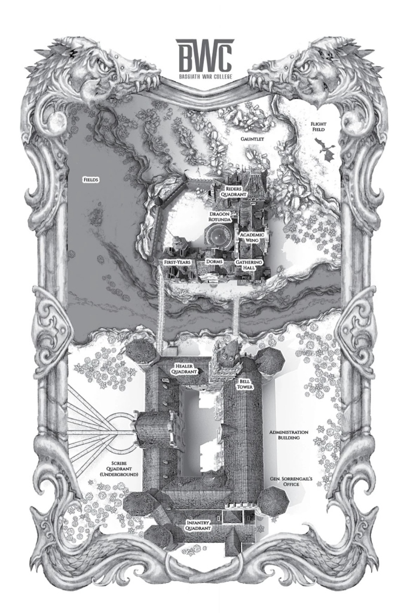
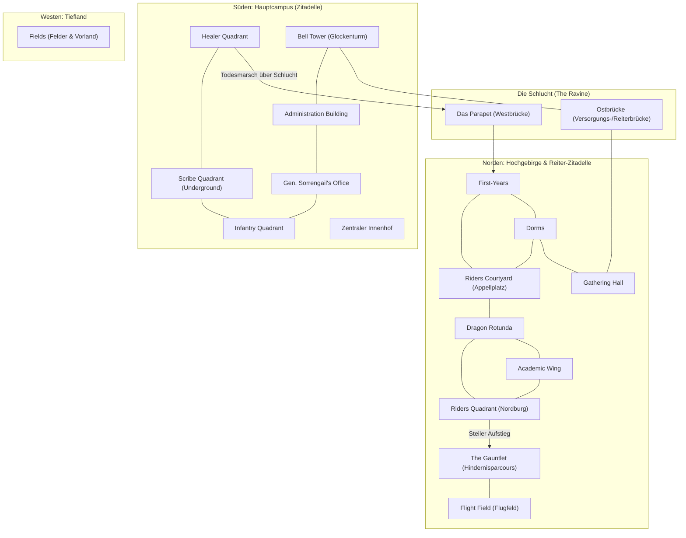

# Bauplan: Basgiath War College (Fourth Wing) – Minecraft ATM 11

---

## 1. Projektvision & Grundkonzept

Dieses Dokument dient als inhaltlicher Masterplan für den Nachbau des **Basgiath War College (BWC)** aus *Fourth Wing* in **Minecraft – All the Mods 11 (ATM 11)**.

Basgiath ist keine gewöhnliche mittelalterliche Burg, sondern eine gewaltige, in schroffe Gebirgsklippen geschlagene Militärakademie. Die Architektur spiegelt die Funktion wider:
- **Südlicher Hauptkomplex:** Streng symmetrisch, monumental, akademisch-militärisch (Infanterie, Heiler, Schreiber, Verwaltung).
- **Die Schlucht (The Ravine) & Das Parapet:** Eine tiefe, windige Felsschlucht mit reißendem Fluss in der Tiefe, überspannt von zwei schmalen Steinbrücken.
- **Nördliche Zitadelle (Riders Quadrant):** Schroff, wehrhaft, vertikal gestaffelt, direkt an und in die steilen Bergflanken gebaut – eine Festung innerhalb der Festung.
- **Nordöstliches Hochgebirge:** *The Gauntlet* (tödlicher vertikaler Kletter- und Hindernisparcours) und das *Flight Field* (Flugfeld der Drachen).

---

## 2. Maßstab & Höhenstaffelung (Mega-Build-Konzept)

> [!IMPORTANT]
> **Warum dieser Maßstab so groß gewählt werden muss:**
> In Minecraft benötigen organische Formen (wie die **riesigen Drachenstatuen in der Dragon Rotunda** oder echte Drachen auf dem *Flight Field*) eine Mindestgröße von **25–45 Blöcken pro Statue**, damit Köpfe, Flügel, Krallen und die spezifischen Schwanzformen (Morgenstern, Dolch, Skorpion etc.) erkennbar detailliert sind.
> Deshalb wird die **Dragon Rotunda als Referenzmaßstab (Ø 111 Blöcke)** gesetzt und die gesamte Karte proportional daran ausgerichtet!

### 2.1 Optimale Nutzung der Bauhöhe (`Y = -64` bis `Y = 319`)
Damit die gewaltige Nordburg des *Riders Quadrant*, die Kuppel der *Dragon Rotunda* (ca. 80 Blöcke hoch!) sowie der darüber liegende *Gauntlet* und das *Flight Field* nicht an das Höhenlimit (`Y = 319`) stoßen, wird das gesamte Terrain bewusst **tief angesetzt**:

| Bereich | Empfohlenes Y-Level | Vertikale Höhe / Spielraum | Beschreibung |
| :--- | :--- | :--- | :--- |
| **Flussbett der Schlucht** | `Y = -35 bis -25` | — | Tief eingeschnittener, reißender Gebirgsfluss am Grund der Schlucht. |
| **Scribe Quadrant (Underground)** | `Y = -50 bis +45` | **95 Blöcke hoch!** | Mehrstöckige Katakomben, monumentale Hallen und Archive im Fels unter dem Hauptcampus. |
| **Tiefland im Westen (*Fields*)** | `Y = 10 bis 25` | — | Weite Ebenen, Felder und Wälder westlich unterhalb des Bergmassivs. |
| **Plateau Süd-Campus (Hauptkomplex)** | `Y = 55` | Gebäude bis `Y = 185` | Grundniveau für *Infantry*, *Healer*, *Administration* und den großen Innenhof. |
| **Brücken (*Parapet* & Ostbrücke)** | `Y = 70` | **100 Blöcke Abgrund!** | 100 Blöcke freier Fall bis zum Fluss (`Y = -30`) – sorgt für echte Schwindelgefühle. |
| **Riders Quadrant (Hof & Südtrakt)** | `Y = 75 bis 85` | Gebäude bis `Y = 160` | *First-Years*, *Dorms*, *Gathering Hall* und der riesige Appellplatz (*Courtyard*). |
| **Dragon Rotunda (Zentralbau)** | `Y = 80 bis 165` | **85 Blöcke Innen-/Kuppelhöhe** | Genug Raum für das Amphitheater und die haushohen Drachenstatuen. |
| **Riders Quadrant (Nordburg)** | `Y = 90 bis 230` | **140 Blöcke Festungshöhe** | Die massive Hauptzitadelle, die direkt in die steile Felswand übergeht. |
| **The Gauntlet (Spießrutenlauf)** | `Y = 130 bis 255` | **125 Blöcke Kletterhöhe** | Steil ansteigende Felsschlucht nördlich der Zitadelle bis hoch zum „Kamin“ (*The Chimney*). |
| **Flight Field (Flugfeld)** | `Y = 240 bis 255` | Bis `Y = 319` Luftraum | Hochplateau im Nordosten – lässt noch **65–80 Blöcke Luftraum** für fliegende Drachen! |

> [!TIP]
> **Optionaler Server-Tipp für ATM 11:** Falls ihr noch höhere Berge über dem *Flight Field* bauen wollt, lässt sich in NeoForge/ATM 11 per einfachem `dimension_type`-Datapack das Build-Limit problemlos auf `Y = 512` oder `Y = 1024` anheben. Mit der obigen Tabelle ab `Y = -50` passt das gesamte Projekt aber auch komplett ohne Datapack in die Standard-Bauhöhe bis `Y = 319`!

---

### 2.2 Konkrete Block-Dimensionen (Proportionales Karten-Grid)

Ausgehend von der **Dragon Rotunda mit 111 Blöcken Durchmesser** ergeben sich nach den Proportionen der Karte folgende Mindestmaße:

| Bauwerk / Zone | Größe in Blöcken (Breite × Tiefe) | Warum diese Größe? |
| :--- | :--- | :--- |
| **Gesamtes Projektgebiet** | **ca. `1.800 × 2.500 Blöcke`** | Umfasst Süd-Campus, Schlucht, Reiter-Zitadelle, Gauntlet, Flight Field & Fields. |
| **1. Dragon Rotunda** | **Ø `111 Blöcke` (Höhe: `85 Blöcke`)** | Bietet Platz für **6 riesige Drachenstatuen (je 25–35 Blöcke groß)** + Amphitheater + Kartenpodium. |
| **2. Riders Quadrant (Gesamt)** | **ca. `420 × 460 Blöcke`** | Die gesamte nördliche Festung inkl. Wehrmauern, Höfen und Trakten. |
| **↳ Riders Courtyard (Appellplatz)** | **ca. `190 × 220 Blöcke`** | Groß genug, dass beim Appell ganze Drachen-Geschwader auf den Mauern und dem Hof Platz finden. |
| **↳ First-Years & Dorms (Südkante)** | **ca. `280 × 75 Blöcke`** | Mehrstöckige Kasernen- und Schlafsaal-Trakte entlang der Schluchtkante. |
| **↳ Gathering Hall** | **ca. `120 × 95 Blöcke`** | Monumentale Versammlungshalle mit langen Tafeln für hunderte Kadetten. |
| **↳ Academic Wing** | **ca. `110 × 170 Blöcke`** | Platz für große Sparring-Arenen (Mattenräume), Waffenkammern und Hörsäle. |
| **↳ Riders Nordburg** | **ca. `230 × 150 Blöcke`** | Der hoch aufragende Festungskern direkt am Fuß des Gauntlets. |
| **3. Das Parapet (Westbrücke)** | **`210 Blöcke` lang, `1–2 Blöcke` breit** | Entspricht den ~200 Schritten über den Abgrund aus dem Buch. |
| **4. Ostbrücke** | **`180 Blöcke` lang, `9–11 Blöcke` breit** | Breitere Versorgungs- und Verbindungsbrücke nahe dem Glockenturm. |
| **5. Südlicher Hauptkomplex** | **ca. `520 × 720 Blöcke`** | Die gewaltige U-/Rechteck-Zitadelle südlich der Schlucht. |
| **↳ Zentraler Innenhof (Süd)** | **ca. `180 × 380 Blöcke`** | Weitläufiger Aufmarsch- und Innenhof zwischen West- und Ostflügel. |
| **↳ Healer Quadrant (Nordwest)** | **ca. `170 × 190 Blöcke`** | Inkl. dem großen Nordwest-Eckturm (Ø `65 Blöcke`), in dem der Aufstieg zum Parapet liegt. |
| **↳ Bell Tower (Glockenturm)** | **`75 × 75 Blöcke` (Höhe: `130 Blöcke`)** | Markanter Hochturm am Nordost-Eck des Hofes. |
| **↳ Administration Building (Ost)** | **ca. `140 × 460 Blöcke`** | Gewaltiger Langbau inkl. General Sorrengails Eckturm (Ø `65 Blöcke`) im Südosten. |
| **↳ Infantry Quadrant (Süd)** | **ca. `520 × 180 Blöcke`** | Größter Quadrant mit massiven Ecktürmen, Torhäusern und Kasernen. |
| **↳ Scribe Quadrant (Underground)** | **ca. `450 × 550 Blöcke` (unterirdisch)** | Strahlenförmiges Katakomben- und Bibliotheksnetzwerk unter dem Westflügel. |
| **6. The Gauntlet** | **ca. `260 × 320 Blöcke`** | Ausgedehnte Felsschlucht für riesige, funktionierende *Create*-Hindernisse. |
| **7. Flight Field** | **ca. `450 × 550 Blöcke`** | Weites Hochplateau für dutzende ausgewachsene Drachen (je `40–60 Blöcke` Spannweite). |

---

## 3. Erweiterte Blockpalette (All the Mods 11)

Durch **ATM 11** stehen neben den Vanilla-Blöcken zahlreiche Dekor-, Architektur- und Technik-Mods zur Verfügung (u. a. *Chipped*, *Rechiseled*, *FramedBlocks*, *Macaw's Roofs/Bridges/Windows/Doors*, *Handcrafted*, *Supplementaries*, *Create*, *Ars Nouveau*, *Quark*, *Biomes O' Plenty* / *Regions Unexplored*).

### 3.1 Terraforming: Klippen, Schlucht & Gebirge
Das Gebirge von Basgiath sollte dunkel, rau und verwittert wirken, mit einem Farbverlauf (Gradient) von dunkel/feucht am Schluchtboden zu hellerem, schneebedecktem Fels in den Höhenlagen:
- **Untere Schlucht (feucht/dunkel):**
  - *Vanilla:* `Deepslate`, `Cobbled Deepslate`, `Blackstone`, `Mud Bricks`, `Mossy Cobblestone`
  - *Modded (Chipped / Create / Quark):* `Limestone` (dunkle Varianten), `Crimsite` / `Veridium` (für mineralische Adern), bemooste Deepslate-Varianten aus *Chipped*, *Regions Unexplored* `Argillite` oder `Chalk` für Schichtungen.
- **Mittlere Klippenwand:**
  - *Vanilla:* `Tuff`, `Andesite`, `Stone`, `Gravel`, `Dead Coral Blocks` (für raue Felsstrukturen)
  - *Modded:* *Create* `Scoria` & `Tuff`-Varianten, *Chipped* zerklüftete Andesit-/Steintexturen, *FramedBlocks* (Slopes & Corners für scharfe, schräge Felsüberhänge!).
- **Hochgebirge (Gauntlet & Flight Field):**
  - *Vanilla:* `Light Gray Concrete Powder`, `Calcite`, `Diorite`, `Snow Block`, `Powder Snow`, `Packed Ice`
  - *Modded:* *Create* `Limestone`, gefrostete Steinvarianten, *Macaw's* Eiszapfen / Schneeverwehungen.

### 3.2 Südlicher Hauptkomplex (Verwaltung, Heiler, Infanterie)
Geordneter, monumentaler Festungsstil – heller als der Reiterquadrant, aber dennoch militärisch massiv:
- **Grundmauerwerk (Basis & Sockel):**
  - `Polished Deepslate`, `Deepslate Bricks`, *Create* `Cut Tuff Bricks`, *Chipped* `Heavy Stone Bricks`.
- **Hauptfassaden:**
  - Mix aus `Stone Bricks`, `Cracked Stone Bricks`, `Andesite`, *Create* `Cut Andesite` / `Polished Cut Andesite` und *Rechiseled* `Stone Brick Pillars` für vertikale Lisenen und Strebepfeiler.
- **Akzente & Zierleisten:**
  - *Create* `Cut Limestone Bricks` oder *Quark* `Polished Calcite` für Gesimse, Fensterrahmen (gerade am *Bell Tower* und *Administration Building*).
- **Dächer (Steildächer & Kegeltürme):**
  - Dunkelschiefer- bis Anthrazit-Look: `Deepslate Tile Stairs`, `Blackstone Stairs`, kombiniert mit *Macaw's Roofs* (`Deepslate Roofs`, `Blackstone Steep Roofs`) und *FramedBlocks* für die achteckigen Turmspitzen.
  - Kupfer- oder dunkle Eisen-Dachkanten (*Create* `Industrial Iron Block`, gealtertes Kupfer).

### 3.3 Riders Quadrant (Die schwarze/dunkle Zitadelle)
Der Reiterquadrant muss deutlich bedrohlicher, kantiger und dunkler wirken als der Süd-Campus:
- **Außenmauern & Wehrgänge:**
  - `Blackstone`, `Polished Blackstone Bricks`, `Deepslate Tiles`, *Create* `Cut Scorchia Bricks` (dunkles Anthrazit/Braun-Schwarz), *Chipped* verwitterte Blackstone- und Basalt-Ziegel.
- **Dragon Rotunda (Kuppelbau):**
  - Gerippte Kuppelkonstruktion aus `Polished Basalt`, *Create* `Industrial Iron`, dunklem Quarz/*Scorchia* und getöntem Glas (`Tinted Glass` / *Chipped* Bleiglasfenster in Grau/Schwarz/Gold).
- **Innenräume (Gathering Hall & Dorms):**
  - Dunkles Holz (`Dark Oak`, `Spruce`, *Biomes O' Plenty* `Hellbark` oder `Umbran` Wood), *Handcrafted* Möbel (lange Tafeln, Bänke, Waffenständer), *Supplementaries* Kerzenhalter, Kronleuchter, Wandteppiche und Eisenkäfige.

### 3.4 Blockpalette für die 6 Drachenstatuen in der Dragon Rotunda (und auf dem Flight Field)
Laut Lore stehen in der *Dragon Rotunda* gewaltige Statuen der **sechs bekannten Drachenfarben** des Kontinents (mit ihren charakteristischen Schwanzformen: *Morningstail, Daggertail, Clubtail, Scorpiontail, Swordtail, Feathertail*). Durch ATM 11 lassen sich diese Statuen in farbigen Stein-, Metall- und Schuppen-Texturen statt nur aus einfachem gefärbtem Ton bauen:

1. **Schwarze Drachen (Black Dragons – z. B. Tairn / Codagh):**
   - *Körper & Schuppen:* `Blackstone`, `Polished Blackstone`, *Create* `Cut Scorchia`, *Chipped* `Blackstone Scales` / `Obsidian`-Varianten, `Coal Block`.
   - *Flügelmembranen & Details:* `Deepslate Tiles`, `Tinted Glass`, *FramedBlocks* mit `Black Concrete Powder` für organische Flügelbögen.
2. **Blaue Drachen (Blue Dragons – z. B. Sgaeyl):**
   - *Körper & Schuppen:* *Create* `Asurine` (`Cut Asurine`, `Polished Cut Asurine`), `Dark Prismarine`, `Lapis Block`, `Blue Terracotta`, *Chipped* blaue Glasur-/Prismarin-Schuppen, *Quark* `Blue Nether Bricks` / `Myalite`.
   - *Flügelmembranen:* `Cyan Terracotta`, `Warped Planks` / `Warped Wart Block`.
3. **Grüne Drachen (Green Dragons – z. B. Teine):**
   - *Körper & Schuppen:* *Create* `Veridium` (`Cut Veridium`, `Polished Veridium`), `Oxidized Copper` / `Weathered Copper` (gewachst), *Quark* `Midori Blocks` / `Mossy Cobblestone Bricks`, `Green Terracotta`, *Chipped* Dunkelgrün-Schuppen.
   - *Flügelmembranen:* `Moss Block`, `Dark Prismarine Stairs`, `Green Stained Glass`.
4. **Rote Drachen (Red Dragons – z. B. Thoirt):**
   - *Körper & Schuppen:* *Create* `Crimsite` (`Cut Crimsite`), `Red Nether Bricks`, `Crimson Stem` / `Stripped Crimson Hyphae`, `Mangrove Wood`, *Chipped* `Red Terracotta Tiles`.
   - *Flügelmembranen:* `Nether Wart Block`, `Red Concrete`, *Biomes O' Plenty* `Hellbark`.
5. **Orange Drachen (Orange Dragons – z. B. Baide / Solas):**
   - *Körper & Schuppen:* `Copper Block` / `Exposed Copper` (gewachst), `Red Sandstone` (glatt & gemeißelt), `Orange Terracotta`, `Acacia Wood`, *Create* `Brass Block` (für glänzende Akzente), *Chipped* bernsteinfarbene Blöcke.
   - *Flügelmembranen:* `Honeycomb Block`, `Shroomlight` / `Froglight` (für feurige Augen/Maul).
6. **Braune Drachen (Brown Dragons – z. B. Deigh / Aotrom):**
   - *Körper & Schuppen:* *Create* `Scoria` (`Cut Scoria`, `Polished Cut Scoria`), `Mud Bricks`, `Dripstone Block`, `Brown Terracotta`, `Dark Oak Wood`, *Chipped* erdige Ziegel- und Schuppenblöcke.
   - *Flügelmembranen:* `Packed Mud`, `Spruce Planks`, `Soul Soil`.
7. *(Optionales Easter-Egg)* **Goldene / Schillernde Feathertail-Statue oder Andarna auf dem Flight Field:**
   - *Create* `Ochrum` & `Brass`, `Gold Block`, `Gilded Blackstone` (für den Übergang in *Iron Flame*!), `Yellow Terracotta`.

### 3.5 Scribe Quadrant (Underground)
Klassisch-akademische, endlose Katakomben-Bibliothek mit warmem Licht im Kontrast zum kalten Fels:
- **Gewölbe & Säulen:**
  - *Create* `Cut Ochrum` / `Cut Limestone`, `Polished Tuff`, `Mud Bricks`, *Chipped* kunstvolle Säulenblöcke.
- **Einrichtung:**
  - Tausende Bücherregale (*Chipped* `Bookshelves` bieten dutzende verschiedene Buchrücken-Varianten, Schriftrollen-Regale, Leitern!), `Chiseled Bookshelves`, *Handcrafted* Schreibtische & Lesepulte, *Ars Nouveau* `Archwood`-Akzente und schwebende Magierlichter (`Magebloom` / `Light`-Zauberlampen).

### 3.6 Healer Quadrant
Clean, strukturiert, mit Kräutergewächshäusern und Alchemie-Sälen:
- **Architektur:** Hellere Steinvarianten (`Smooth Stone`, `Calcite`, *Create* `Limestone`), viel Glas für Tageslicht.
- **Ausstattung:** Krankenbetten (*Handcrafted* weiße Betten & Nachttische), Alchemie-Tische, Kräutertöpfe (*Supplementaries* Planters, Hängepflanzen), saubere Wasserbecken.

---

## 4. Detaillierte Zonen-Analyse (anhand der Karte)

---

### Zone 1: Südlicher Hauptkomplex (Main College)

1. **Infantry Quadrant (Südflügel)**
   - **Kartenmerkmal:** Bildet den breiten südlichen Abschluss des U-förmigen Komplexes, flankiert von massiven achteckigen/runden Ecktürmen im Südwesten und Südosten sowie vorgelagerten Torhäusern.
   - **Umsetzung:** Große Kasernenanlagen, Waffenkammern, Trainingshöfe, Wachtürme. Hier beginnt der Zugang für alle Rekruten am Conscription Day (Einberufungstag).

2. **Scribe Quadrant – Underground (Westflügel & Untergrund)**
   - **Kartenmerkmal:** Auf der Karte sticht links ein markantes, querliegendes Gebäude aus dem Westflügel hervor; darunter/daneben sind auf der linken Seite strahlenförmige Linien und ein Halbkreis eingezeichnet (`SCRIBE QUADRANT (UNDERGROUND)`).
   - **Umsetzung:**
     - Oberirdisch: Ein repräsentativer Westbau mit Zugangstreppen in die Tiefe.
     - Unterirdisch: Ein riesiges, halbkreisförmiges Gewölbesystem (`450 × 550 Blöcke`) mit strahlenförmig abgehenden Archiv-Korridoren (genau wie die Linien auf der Karte andeuten!).
     - **Lore-Highlight:** Geheime Tunnel, die von den Archiven durch den Fels unter/neben der Schlucht bis in die Schlafsäle und die Bibliothek des Reiterquadranten führen.

3. **Healer Quadrant (Nordwest-Flügel)**
   - **Kartenmerkmal:** Nördlicher Abschluss des Westflügels, direkt an der Felskante zur Schlucht, mit einem großen runden Eckturm im Nordwesten (Ø `65 Blöcke`).
   - **Umsetzung:** Behandlungsräume (wo u. a. Brennan und Nolon wirkten), Kräutergärten, Lehrsäle. Vom oberen Teil des Nordwest-Turms führt die Wendeltreppe (200+ Stufen) hinauf zum Startpunkt des **Parapets**.

4. **Bell Tower (Glockenturm – Nordost-Innenhof)**
   - **Kartenmerkmal:** Der höchste, am reichsten verzierte Turm des Süd-Campus (`75 × 75 Blöcke`, `130 Blöcke` hoch) mit spitzem Helm, Gauben und Ecktürmchen, direkt am Übergang zur östlichen Brücke.
   - **Umsetzung:** Blickfang des Innenhofs. Im Inneren eine große schwingende Glocke (mit *Create* mechanisch läutbar!).

5. **Administration Building & Gen. Sorrengail's Office (Ostflügel)**
   - **Kartenmerkmal:** Ein gewaltiger, durchgehender Langbau (`140 × 460 Blöcke`) auf der gesamten Ostseite, abgeschlossen durch einen massiven Eckturm im Südosten (`GEN. SORRENGAIL'S OFFICE`).
   - **Umsetzung:**
     - Offiziersquartiere, Stabsräume, Strategie-Säle.
     - **Büro von General Lilith Sorrengail:** Großes rundes/achteckiges Turmzimmer (Ø `65 Blöcke`) im Südosten. **Pflicht-Detail:** Die riesige, dreidimensionale Relief-Karte des Kontinents (Navarre & Poromiel) im Boden bzw. in der Raummitte, auf der Grenzposten markiert sind.

6. **Zentraler Innenhof (Main Courtyard)**
   - **Kartenmerkmal:** Langgestreckter, von Arkaden und hohen Mauern eingefasster Hof (`180 × 380 Blöcke`) in der Mitte des Süd-Komplexes.

---

### Zone 2: Die Schlucht (The Ravine) & Die Brücken

1. **Die Schlucht (The Ravine)**
   - Tiefe, schroffe Felsschlucht (`100 Blöcke` tief), die den gesamten Komplex von West nach Ost durchschneidet. Unten rauscht ein reißender Gebirgsfluss (weiße Gischt durch `Cobwebs`, `White Stained Glass`, *Chipped* Glasblöcke und Lagerfeuer-Rauch).
2. **Das Parapet (Westliche Brücke)**
   - **Kartenmerkmal:** Schmale, schnurgerade Steinverbindung (`210 Blöcke` lang) vom Nordwest-Turm des *Healer Quadrant* zum *First-Years*-Gebäude des *Riders Quadrant*.
   - **Umsetzung:** Ca. 1–2 Blöcke breit (für den echten Nervenkitzel lassen sich `Stone Brick Walls` oder *FramedBlocks* nutzen), völlig ohne Geländer, verwitterte Steine, an manchen Stellen leicht ausgebrochen oder durch Regen/Eis rutschig (`Packed Ice` unter Teppichen oder glänzende *Chipped*-Blöcke).
3. **Östliche Verbindungsbrücke**
   - **Kartenmerkmal:** Zweite Brücke weiter östlich (`180 Blöcke` lang, `9–11 Blöcke` breit) zwischen dem *Bell Tower* und der Südseite des Reiterquadranten (zwischen *Dorms* und *Gathering Hall*).
   - **Umsetzung:** Etwas breiter als das Parapet, genutzt für Versorgung, Ausbilder oder offizielle Übergänge.

---

### Zone 3: Nördliche Zitadelle – Riders Quadrant

1. **First-Years (Südwest-Trakt)**
   - **Kartenmerkmal:** Direkt am Nordende des Parapets gelegenes Gebäude mit kleinem Innenhof/Eingangsbereich, wo die Überlebenden des Parapets registriert werden.
   - **Umsetzung:** Große Gemeinschaftsschlafsäle mit langen Reihen von Stockbetten, Waschbereiche, direkter Zugang zum Appellplatz.

2. **Dorms (Südlicher Mitteltrakt)**
   - **Kartenmerkmal:** Zwischen *First-Years* und *Gathering Hall* direkt an der südlichen Klippenkante gelegen.
   - **Umsetzung:** Einzelzimmer für Kadetten des 2. und 3. Jahres sowie größere Quartiere für Wingleader/Squadleader (wie Xadens und Violets Zimmer – mit schweren Holztüren, magischen Schlössern, Kleiderschränken und großen Fenstern Richtung Schlucht/Berge).

3. **Gathering Hall (Südost-Trakt)**
   - **Kartenmerkmal:** Großer Hallenbau (`120 × 95 Blöcke`) im Südosten des Reiterquadranten.
   - **Umsetzung:** Hohe Decken, lange Tische für die einzelnen Wings und Squads, ein erhöhtes Podium für die Führungsebene (Wingleader), ein Durchgang zur Küche und zum Frühstücksbereich.

4. **Riders Courtyard (Großer westlicher Appellplatz)**
   - **Kartenmerkmal:** Großer, offener Platz (`190 × 220 Blöcke`) im Nordwesten des Reiterquadranten, nach Westen und Norden durch eine dicke, abgewinkelte Festungsmauer mit Wehrgang gegen den Abgrund geschützt.
   - **Umsetzung:** Hier findet jeden Morgen *Roll Call* (Appell) statt, hier landen ausgewachsene Drachen (je `35–50 Blöcke` groß) auf den breiten Zinnen der Westmauer, und hier werden Strafen oder Bekanntmachungen vollzogen.

5. **Dragon Rotunda (Zentraler Kuppelbau – Ø `111 Blöcke`, Höhe `85 Blöcke`)**
   - **Kartenmerkmal:** Kreisrundes Monumentalgebäude mit Kuppeldach direkt im Herzen des Reiterquadranten.
   - **Innenraum-Architektur (Mega-Scale für die Drachenstatuen):**
     - **Zentrum (Ø `31 Blöcke`):** Das Podium für *Battle Brief* (Gefechtsbesprechung) mit einer eingelassenen Relief-Karte des Kontinents, auf der Professoren (Markham & Devera) die aktuellen Angriffe an den Grenzen besprechen.
     - **Amphitheater-Ränge (Radius `16 bis 42 Blöcke`):** Steil ansteigende, konzentrische Sitzreihen aus dunklem Stein und Holz für die vier Wings des Reiterquadranten, durchbrochen von breiten Treppenaufgängen.
     - **Der äußere Statuen-Ring (Radius `42 bis 53 Blöcke`, alle 60° versetzt):** Entlang der gewaltigen Außenpfeiler und über die oberen Galerien ragend stehen die **6 kolossalen Drachenstatuen** (jeweils **`25–35 Blöcke` hoch** und mit ausgebreiteten oder angelegten Schwingen in die Kuppel ragend) in den 6 Farben der Drachenarten (**Schwarz, Blau, Grün, Rot, Orange, Braun** – siehe Blockpalette in Abschnitt 3.4). Jede Statue zeigt zudem eine der verschiedenen Schwanzwaffen (*Morningstail, Daggertail, Clubtail, Scorpiontail, Swordtail, Feathertail*).
     - **Kuppeldecke (`Y = 125 bis 165`):** Freitragende Rippenkuppel aus Basalt, *Create* `Industrial Iron` und getöntem Glas, beleuchtet von schwebenden *Ars Nouveau*-Magierlichtern.

6. **Academic Wing (Östlicher Mittelbau)**
   - **Kartenmerkmal:** Verbindet die *Gathering Hall* im Süden mit der Hauptburg im Norden, direkt östlich der *Dragon Rotunda* (`110 × 170 Blöcke`).
   - **Umsetzung:**
     - **Der Mattenraum (Assessment / Challenges Hall):** Großer Trainingsraum mit gepolsterten Kampfmatten am Boden und Zuschauerrängen, auf denen Kadetten im Sparring gegeneinander antreten.
     - Waffenkammern (wo Violet ihre Dolche aufbewahrt/schärft), Unterrichtsräume für Geschichte, Strategie und Signet-Training.

7. **Riders Quadrant Hauptburg (Nordtrakt)**
   - **Kartenmerkmal:** Der höchste, am stärksten befestigte Teil der Zitadelle, der direkt in die Felswand im Norden übergeht.
   - **Umsetzung:** Quartiere der Kommandanten und Professoren (Kaori, Markham, Carr, Devera), Gefängniszellen/Verhörräume im Keller, sowie das Nordtor, das hinaus zum *Gauntlet* und *Flight Field* führt.

---

### Zone 4: Außenbereiche (Fields, Gauntlet, Flight Field)

1. **Fields (Westliches Tiefland)**
   - **Kartenmerkmal:** Große, flache Ebene westlich unterhalb des Felsplateaus (`FIELDS`), durchzogen von einer Hangkante und Baumgruppen.
   - **Umsetzung:** Landwirtschaftliche Versorgungsflächen, Weiden (für die Schafe/Rinder zur Drachenfütterung) und Übungsfelder der Infanterie.

2. **The Gauntlet (Nördliches Felslabyrinth)**
   - **Kartenmerkmal:** Direkt nördlich des *Riders Quadrant* in eine steile, zerklüftete Felsschlucht/Bergflanke eingebettet (`GAUNTLET`).
   - **Umsetzung:** Ein vertikaler Hindernisparcours, der sich den Berg hinaufwindet:
     - Balancierbalken über dem Abgrund
     - Schwingende Pendel & drehende Zahnräder/Walzen (**perfekt mit der Mod *Create* animierbar!**)
     - Rutschige Schrägen und Seilbrücken
     - **Der Kamin (The Chimney):** Ein enger, vertikaler Felsschacht am Ende des Parcours, den man hinaufklettern muss, um oben auf dem Gipfelplateau das Ziel zu erreichen.

3. **Flight Field (Nordöstliches Hochplateau)**
   - **Kartenmerkmal:** Großes, offenes Plateau im Nordosten (`FLIGHT FIELD`), abgegrenzt durch eine gezackte Klippenkante, mit einem fliegenden Drachen-Symbol.
   - **Umsetzung:**
     - Weite Aufmarschfläche für das *Threshing* (Dreschen) und die Flugübungen.
     - Gebaute Drachen-Statuen oder organische Builds von landenden/startenden Drachen (z. B. *Tairn* als riesiger schwarzer Morningstail-Drache und *Andarna* als kleiner goldener/schillernder Drache).
     - Weiter östlich/nördlich kann ein felsiger Gebirgspass angedeutet werden, der ins **Vale (Das Tal der Drachen)** führt.

---

## 5. ATM 11 Features: Technik, Magie & Bautechniken

Da ihr in **All the Mods 11** spielt, könnt ihr Basgiath nicht nur optisch, sondern auch funktional zum Leben erwecken:

### 5.1 Mechanik & Bewegung (*Create* Mod)
- **Der Gauntlet:** Nutzt *Create* `Mechanical Bearings`, `Windmill Bearings` und `Gantry Shafts`, um **echte rotierende Walzen, bewegliche Plattformen und Pendel** im Gauntlet-Parcours zu bauen!
- **Scribe Quadrant Bücheraufzüge:** Im Buch werden mechanische Aufzüge und Seilzüge beschrieben, mit denen schwere Folianten zwischen den unterirdischen Ebenen transportiert werden – ideal für *Create* `Pulley`-Aufzüge oder `Contraptions`.
- **Tore & Zugbrücken:** Massive Fallgitter am Infanterie-Tor und zum Reiterquadranten.

### 5.2 Magie & Atmosphäre (*Ars Nouveau* / *Mahou Tsukai* / Beleuchtung)
- **Magelights (Magierlichter):** In Basgiath gibt es keine elektrische Beleuchtung, sondern schwebende *Magelights*. Mit *Ars Nouveau* (`Light`-Zauber oder `Sconce` / `Jar of Light`) oder unsichtbaren Lichtblöcken lassen sich warm oder bläulich leuchtende Kugeln erzeugen, die frei in den Gängen und der *Dragon Rotunda* schweben.
- **Wards (Schutzzauber):** Dezente Partikeleffekte an den Grenzen von Basgiath.
- **Waystones:** Versteckte *Waystones* (z. B. als Runensteine getarnt) im *Infantry Quadrant*, *Riders Courtyard*, *Scribe Archive* und auf dem *Flight Field*, um die enormen Laufwege im Projekt schnell zu überbrücken.

### 5.3 Empfohlene Bau-Hilfsmittel in ATM 11
Für ein Projekt dieser Größenordnung im Survival- oder Creative-Modus:
1. **Building Gadgets 2:** Unverzichtbar!
   - *Building Gadget:* Für schnelle Mauern, Dächer und Felswände.
   - *Copy-Paste Gadget:* Um Fensterachsen am *Administration Building*, Kasernen-Segmente oder Säulen im *Scribe Quadrant* zu duplizieren.
   - *Exchanging Gadget:* Um nachträglich Textur-Verläufe (Weathering) in bestehende Steinwände einzuarbeiten.
2. **Construction Wand (Infinity Wand):** Zum schnellen Hochziehen der riesigen Klippen und Festungsmauern.
3. **FramedBlocks:** Der wichtigste Mod für schräge Dächer, das 45°-abgewinkelte Mauerwerk am *Riders Courtyard* und die runde Kuppel der *Dragon Rotunda*.
4. **RFTools Builder:** Perfekt, um riesige Felsmassen für den unterirdischen *Scribe Quadrant* oder die *Schlucht* automatisch auszuheben (Quarry) oder Grundformen (Kuppeln, Zylinder für Türme) vorzubauen.

---

## 6. Empfohlener Phasenplan (Roadmap)

Damit das Großprojekt übersichtlich bleibt und früh beeindruckende Ergebnisse liefert:

### Phase 1: Absteckung & Grobes Terraforming (Layout-Grid)
- [ ] Gelände abstecken: Markierungsblöcke (farbige Wolle/Concrete) auf den entsprechenden Y-Levels setzen.
- [ ] **Die Schlucht (The Ravine)** und die Klippenkanten zwischen Nord- und Süd-Campus grob ausheben bzw. aufschütten.
- [ ] **Das Parapet** und die **Ostbrücke** als zentrale Verbindungsachsen spannen – daran orientiert sich die gesamte Ausrichtung von Nord und Süd!

### Phase 2: Der Riders Quadrant (Herzstück des Projekts)
- [ ] Südliche Klippengebäude hochziehen: **First-Years**, **Dorms** und **Gathering Hall**.
- [ ] Die massive westliche **Festungsmauer** und den **Riders Courtyard** anlegen.
- [ ] **Dragon Rotunda** (Zentralkuppel) und **Academic Wing** bauen.
- [ ] Die hoch aufragende **Nordfestung** in die hintere Bergwand integrieren.

### Phase 3: Gauntlet & Flight Field (Nordosten)
- [ ] Nordöstliches Bergmassiv hochziehen.
- [ ] **The Gauntlet** in die Felswand bauen (inkl. *Create*-Mechaniken für drehende Hindernisse und dem *Chimney*).
- [ ] **Flight Field** auf dem Hochplateau anlegen (optional: 1–2 große Drachen-Builds auf dem Feld oder im Anflug).

### Phase 4: Südlicher Hauptkomplex (Die große Zitadelle)
- [ ] Nordflügel an der Schlucht: **Healer Quadrant** (mit Aufgang zum Parapet) und den **Bell Tower**.
- [ ] Ostflügel: Das lange **Administration Building** und der Südost-Turm mit **Gen. Sorrengail's Office**.
- [ ] Südflügel: **Infantry Quadrant** mit den markanten Ecktürmen und Toranlagen.
- [ ] Westflügel: Oberirdischer Zugang zum **Scribe Quadrant** und Gestaltung des großen **Innenhofs**.

### Phase 5: Scribe Quadrant (Underground) & Geheimgänge
- [ ] Unterirdische Katakomben und das strahlenförmige Archiv-System unter dem Westflügel aushöhlen.
- [ ] Geheimgänge vom Archiv bis hoch in den *Riders Quadrant* (z. B. hinter Bücherregalen mit *Create* Piston-Doors) anlegen.

### Phase 6: Feinschliff, Landschaft & Details
- [ ] Westliches Tiefland (**Fields**) und die umliegenden Wälder (mit *Biomes O' Plenty* / *Regions Unexplored* Bäumen) gestalten.
- [ ] Texturierung (Block-Gradients an Klippen und Mauern), Beleuchtung (*Magelights*) und Inneneinrichtung (*Handcrafted* / *Supplementaries*).
