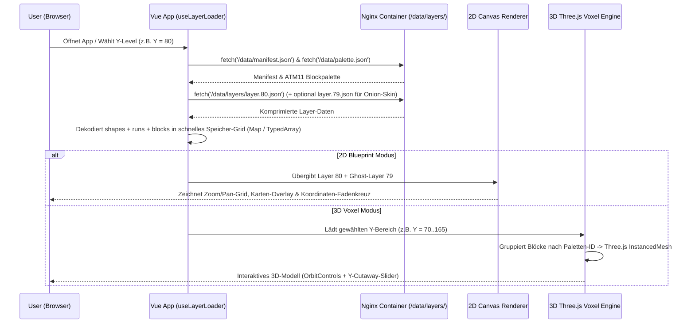

# Website-Architektur & Visualisierungs-Konzept (2D / 3D Layer-Viewer)

Dieses Dokument beschreibt die technische Planung für die **interaktive Basgiath-Planungs-Website** auf Basis von **Vue 3 + Vite + Three.js**, angelehnt an die Struktur von `fubsi-site` und optimiert für das direkte **Git-Stack-Deployment über Portainer**.

---

## 1. System-Überblick & Zielsetzung

Die Website dient als digitales Bauplanungs-Tool („Web-Litematica“) für das Basgiath-Großprojekt (`1.800 × 2.500 Blöcke`, `Y = -50` bis `Y = 319`):
1. **2D-Layer-Blueprint-Ansicht:** Schichtweises Durchblättern der `layer.{Y}.json`-Dateien mit Koordinaten-Grid, Originalkarten-Overlay, „Onion-Skinning“ (Vorherige Ebene `Y-1` durchscheinend) und Stücklisten-Berechnung pro Ebene.
2. **3D-Voxel-Ansicht:** Interaktive 3D-Vorschau der geladenen Layer im Browser (mit Querschnitt-Slider zum Hineinschauen in die *Dragon Rotunda* oder den *Scribe Quadrant*).
3. **Dynamisches Nachladen (`layer.{Y}.json`):** Kein riesiger Monolith, sondern modulare JSON-Dateien pro Y-Ebene, die bei Bedarf per `fetch()` geladen und gecacht werden.
4. **Portainer-Ready (Schema `fubsi-site`):** Multi-Stage Docker-Build (`node:20-alpine` → `nginx:alpine`) mit `docker-compose.yml` für 1-Klick-Deployment in Portainer.

---

## 2. Ordnerstruktur (angelehnt an `fubsi-site`)

Damit Portainer sowohl aus dem Repository-Root als auch analog zu `fubsi-site` funktioniert, wird folgende Struktur angelegt:

```text
basgiath-project/
├── docs/
│   ├── basgiath-map.jpg             # Originale Karte aus Fourth Wing
│   ├── bauplan-basgiath.md          # Inhaltlicher Masterplan & Dimensionen
│   └── website-architektur.md       # Dieses Architektur-Dokument
├── tools/                           # (Optional) Python/Node-Skripte zum Generieren von layer.Y.json
│   └── generate-layers.js           # Erzeugt Layer-JSONs aus Grundformen oder .litematic/.nbt
├── docker-compose.yml               # Root-Compose für direktes Portainer Git-Deployment
└── frontend/                        # Vue 3 + Vite App (exakt nach fubsi-site Schema)
    ├── .dockerignore
    ├── .gitignore
    ├── Dockerfile                   # Multi-Stage Build (Node 20 Alpine -> Nginx Alpine)
    ├── docker-compose.yml           # Compose im Frontend-Ordner (wie in fubsi-site)
    ├── nginx.conf                   # SPA-Routing + Gzip-Kompression für große JSON-Layer
    ├── index.html
    ├── package.json
    ├── vite.config.js
    ├── public/
    │   ├── basgiath-map.jpg         # Karten-Overlay für den 2D/3D-Viewer
    │   └── data/
    │       ├── manifest.json        # Metadaten: Min/Max Y, Zonen-Boxen, verfügbare Layer
    │       ├── palette.json         # Zentrale ATM 11 Blockpalette (Farben, Mod-Namen, Texturen)
    │       └── layers/
    │           ├── layer.-50.json   # Tiefste Ebene (Scribe Quadrant Katakomben)
    │           ├── ...
    │           ├── layer.70.json    # Ebene des Parapets & der Ostbrücke
    │           ├── layer.80.json    # Bodenebene Dragon Rotunda & Riders Courtyard
    │           └── layer.Y.json     # Dynamisch geladene Y-Ebenen
    └── src/
        ├── App.vue                  # Grundlayout mit bg-grid, AppSidebar, AppNav & Page-Slide
        ├── main.js
        ├── style.css
        ├── assets/
        │   ├── agency.css           # Basgiath Dark/Obsidian/Gold Theme (auf Basis von fubsi-site)
        │   └── objects.css          # Wiederverwendbare UI-Klassen, Badges, Shine-Effekte
        ├── components/
        │   ├── AppNav.vue           # Obere Navigation (Overview, 2D Blueprint, 3D Viewer, Palette)
        │   ├── AppSidebar.vue       # Linke Sidebar mit Projektstatus & Quick-Jump
        │   ├── LayerSlider.vue      # Vertikaler Y-Level-Regler (Y = -50 bis 319) + Onion-Skin Toggle
        │   ├── BlockInspector.vue   # Zeigt beim Hover X/Y/Z, ATM11-Block, Mod & Stückliste
        │   ├── Viewer2DCanvas.vue   # Hochperformanter HTML5 Canvas 2D-Renderer (Pan/Zoom)
        │   └── Viewer3DVoxel.vue    # Three.js InstancedMesh 3D-Renderer mit Y-Cutaway-Slider
        ├── composables/
        │   └── useLayerLoader.js    # Dynamisches Laden, Caching & Dekomprimieren von layer.Y.json
        ├── router/
        │   └── index.js             # Vue Router (HomeView, Map2DView, Voxel3DView, PaletteView)
        └── views/
            ├── HomeView.vue         # Projekt-Dashboard, Phasen-Fortschritt & Zonen-Übersicht
            ├── Blueprint2DView.vue  # Vollbild 2D-Karten- & Layer-Planer
            ├── Voxel3DView.vue      # Interaktive 3D-Ansicht (Gesamt & Zonen-Fokus wie Rotunda)
            └── PaletteView.vue      # ATM 11 Block-Katalog (Drachenfarben, Festungsmauern etc.)
```

---

## 3. Smartes Datenformat für `layer.{Y}.json`

### Warum ein reines Einzelblock-Array bei Mega-Builds problematisch wäre
Bei einer Fläche von `1.800 × 2.500 Blöcken` hat eine einzige Y-Ebene theoretisch **4,5 Millionen Koordinatenpunkte**. Würde man jeden Punkt als `{ "x": 10, "z": 20, "block": "create:cut_scorchia_bricks" }` speichern, wäre **eine einzige `layer.Y.json` über 150 MB groß**.

### Die Lösung: Hybrides 3-Stufen-Format in `layer.{Y}.json`
Unser Loader (`useLayerLoader.js`) unterstützt in jeder `layer.{Y}.json` gleichzeitig **drei kompatible Formate**, die sich perfekt ergänzen:

1. **Zentrale Block-Kurz-IDs über `palette.json`:**
   Alle ATM 11 Blöcke werden einmalig in `public/data/palette.json` definiert (inkl. Hex-Farbe für 2D/3D, Mod-Zugehörigkeit und deutschem/englischem Namen). In `layer.{Y}.json` wird entweder die kurze Paletten-ID (z. B. `14` oder `"scorchia_brick"`) oder die volle Block-ID genutzt.
2. **Geometrische Primitive (`shapes`) für schnelles Architektur-Prototyping:**
   Ermöglicht es, Grundrisse (Mauern, Ringe der *Dragon Rotunda*, Brücken, Türme) mit wenigen Zeilen JSON zu beschreiben. Der Browser rechnet diese beim Laden automatisch in echte Minecraft-Blockkoordinaten um!
3. **Run-Length-Encoding (`runs`) & Einzelblöcke (`blocks`) für exakte Blockdaten:**
   - `blocks`: `[[x, z, blockId], ...]` für feine organische Details (z. B. die **6 Drachenstatuen** in der Rotunde).
   - `runs`: `[[z, startX, length, blockId], ...]` fasst nebeneinanderliegende gleiche Blöcke einer Zeile zusammen und reduziert die Dateigröße um **bis zu 98 %**.

### Beispiel 1: `public/data/palette.json`
```json
{
  "blocks": {
    "1": {
      "id": "minecraft:polished_blackstone_bricks",
      "name": "Polished Blackstone Bricks",
      "mod": "Vanilla",
      "category": "Riders Quadrant",
      "color": "#26232a",
      "roughness": 0.8
    },
    "2": {
      "id": "create:cut_scorchia_bricks",
      "name": "Cut Scorchia Bricks",
      "mod": "Create",
      "category": "Riders Quadrant",
      "color": "#1b1d21",
      "roughness": 0.7
    },
    "10": {
      "id": "create:cut_asurine",
      "name": "Cut Asurine (Blauer Drache)",
      "mod": "Create",
      "category": "Dragon Statues",
      "color": "#2c5d8f",
      "roughness": 0.5
    },
    "11": {
      "id": "create:cut_crimsite",
      "name": "Cut Crimsite (Roter Drache)",
      "mod": "Create",
      "category": "Dragon Statues",
      "color": "#7f2329",
      "roughness": 0.5
    },
    "12": {
      "id": "create:cut_veridium",
      "name": "Cut Veridium (Grüner Drache)",
      "mod": "Create",
      "category": "Dragon Statues",
      "color": "#28664b",
      "roughness": 0.5
    },
    "13": {
      "id": "create:cut_ochrum",
      "name": "Cut Ochrum (Goldener Drache / Archiv)",
      "mod": "Create",
      "category": "Dragon Statues",
      "color": "#c99a3e",
      "roughness": 0.4
    }
  }
}
```

### Beispiel 2: `public/data/layers/layer.80.json` (Bodenebene Dragon Rotunda & Statuen-Sockel)
```json
{
  "y": 80,
  "label": "Dragon Rotunda – Hauptboden & Statuen-Sockel",
  "zone": "riders-quadrant",
  "shapes": [
    {
      "type": "circle",
      "cx": 0,
      "cz": 0,
      "r": 55,
      "filled": false,
      "thickness": 3,
      "block": 2,
      "comment": "Außenmauer der Dragon Rotunda (Ø 111 Blöcke)"
    },
    {
      "type": "circle",
      "cx": 0,
      "cz": 0,
      "r": 15,
      "filled": true,
      "block": 1,
      "comment": "Battle Brief Zentralpodium (Ø 31 Blöcke)"
    }
  ],
  "runs": [
    [-60, -12, 25, 1],
    [-59, -12, 25, 1]
  ],
  "blocks": [
    [0, -47, 10],
    [41, -23, 11],
    [41, 23, 12],
    [0, 47, 13]
  ]
}
```

---

## 4. Funktionsweise der 2D- und 3D-Visualisierung



### 4.1 Features der 2D-Visualisierung (`Viewer2DCanvas.vue`)
- **Stufenloser Zoom & Pan:** Von der Gesamtübersicht (`1.800 × 2.500 Blöcke`) bis auf den einzelnen Block heranzoomen (ab hohem Zoomfaktor mit eingeblendetem Block-Raster und Koordinaten).
- **Originalkarten-Hintergrund (Opacity-Slider):** Die Originalkarte (`basgiath-map.jpg`) liegt skaliert im Hintergrund und kann per Schieberegler von `0 %` bis `100 %` Deckkraft überblendet werden.
- **Onion-Skinning (Bau-Modus für Minecraft):** Blendet Ebene `Y - 1` halbtransparent/gestrichelt unter der aktuellen Ebene `Y` ein – ideal, um beim Bauen der Kuppel oder der Drachenstatuen genau zu sehen, wo Blöcke versetzt auf der darunterliegenden Schicht sitzen.
- **Live-Stückliste (Material-Kalkulator):** Berechnet für die aktuell sichtbare Ebene (oder einen ausgewählten Bereich) exakt, wie viele Blöcke und Stacks von welchem ATM 11-Block benötigt werden.

### 4.2 Features der 3D-Visualisierung (`Viewer3DVoxel.vue`)
- **Three.js `InstancedMesh` Performance:** Statt für jeden Block ein eigenes Three.js-Objekt zu erzeugen (was den Browser ab ~5.000 Blöcken ausbremst), wird pro Blocktyp aus `palette.json` nur **ein einziges `InstancedMesh`** gerendert. Damit laufen selbst **100.000+ sichtbare Blöcke mit flüssigen 60 FPS**.
- **Verdeckte Flächen ausblenden (Neighbor Culling):** Ein Block, der an allen 6 Seiten (`X±1, Y±1, Z±1`) von anderen soliden Blöcken umschlossen ist, wird beim Aufbau der 3D-Szene automatisch übersprungen.
- **Interaktiver Querschnitt-Regler (`Y-Min` / `Y-Max` Cutaway):** Man kann im 3D-Viewer jederzeit das Dach der *Dragon Rotunda* (z. B. alles über `Y = 120`) ausblenden, um von oben in das 3D-Amphitheater und auf die **6 farbigen Drachenstatuen** zu blicken.

---

## 5. Design-System (Evolution des `fubsi-site` Schemas)

Das Design übernimmt die markante Architektur aus `fubsi-site` (`Space Grotesk`-Typografie, vertikales Hintergrund-Raster `.bg-grid`, linke `AppSidebar`, `AppNav`, `.page-slide`-Router-Transitions) und kleidet sie in das **Basgiath War College Farbschema**:

| CSS-Variable | Wert | Beschreibung |
| :--- | :--- | :--- |
| `--bg-main` | `#0f1014` | Tiefes Obsidian-Schwarz (angelehnt an den *Riders Quadrant*) |
| `--bg-sidebar` | `#16181f` | Dunkles Basaltschwarz für Sidebar & Inspector-Panels |
| `--accent` | `#e5a93c` | Drachengold / Andarna-Gold für aktive Elemente, Linien & Badges |
| `--accent-secondary` | `#60a5fa` | Signet-Blitzblau (Violet) für Koordinaten-Highlights & 3D-Achsen |
| `--text-white` | `#f3f4f6` | Klares Pergament-Weiß |
| `--text-muted` | `#8b92a5` | Gedämpftes Schiefergrau für sekundäre Infos |
| `--grid-line` | `rgba(229, 169, 60, 0.05)` | Dezentes goldenes Taktik-Raster im Hintergrund |

---

## 6. Docker & Portainer Deployment-Setup

Damit das Projekt in **Portainer** exakt wie `fubsi-site` über **Stacks → Add stack → Repository** gezogen und gebaut werden kann, werden folgende Optimierungen eingesetzt:

### 6.1 `frontend/Dockerfile` (Multi-Stage mit Nginx SPA- & Gzip-Support)
```dockerfile
# --- Build Stage ---
FROM node:20-alpine AS build

WORKDIR /app

COPY package*.json ./
RUN npm install

COPY . .
RUN npm run build

# --- Production Stage ---
FROM nginx:alpine

# Eigene Nginx-Konfiguration für Vue-Router (SPA) & JSON-Gzip-Kompression
COPY nginx.conf /etc/nginx/conf.d/default.conf

# Gebaute Vue-App inklusive public/data/layers/ kopieren
COPY --from=build /app/dist /usr/share/nginx/html

EXPOSE 80

CMD ["nginx", "-g", "daemon off;"]
```

### 6.2 `frontend/nginx.conf` (Wichtig für `layer.Y.json` Performance & Vue Router)
```nginx
server {
    listen 80;
    server_name localhost;
    root /usr/share/nginx/html;
    index index.html;

    # Starke Gzip-Kompression für große layer.Y.json Dateien (spart ~90% Bandbreite)
    gzip on;
    gzip_types application/json text/css application/javascript;
    gzip_min_length 256;

    # Vue Router History-Mode Unterstützung
    location / {
        try_files $uri $uri/ /index.html;
    }

    # Layer-JSONs ohne aggressives Browser-Caching während der Bauphase
    location /data/ {
        add_header Cache-Control "no-cache";
    }
}
```

### 6.3 `docker-compose.yml` (Kompatibel aus Root & `frontend/`)
Im Projekt-Root liegt eine `docker-compose.yml` mit `context: ./frontend` (sodass man in Portainer nicht einmal den Compose-Pfad umstellen muss), und zusätzlich eine im `frontend/`-Ordner analog zu `fubsi-site`:

```yaml
version: '3.8'
services:
  basgiath-site:
    build:
      context: ./frontend
      dockerfile: Dockerfile
    container_name: basgiath-visualizer
    ports:
      - "4001:80"
    restart: unless-stopped
```
*(Hinweis: Port `4001:80` gewählt, damit der Container problemlos parallel zu `fubsi-site` auf Port `4000` auf demselben Host laufen kann – kann natürlich jederzeit auf `4000:80` gesetzt werden).*
